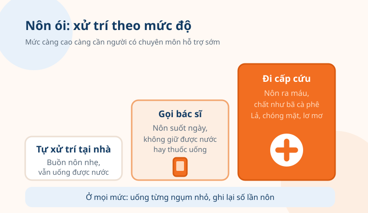
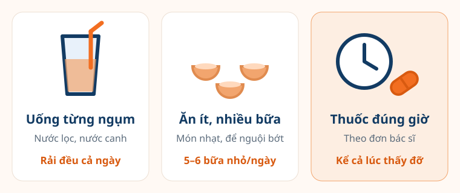

"Má cứ ăn được vài muỗng là nôn hết ra, cả nhà không biết phải làm sao" —
đây là câu người thân hay nói nhất khi chăm sóc người bệnh ung thư tại nhà.
Nôn ói làm người bệnh mệt lả, sợ ăn, sợ uống thuốc; còn người chăm sóc thì
lúng túng giữa hai nỗi lo: ép ăn thêm hay để yên, tự xoay xở hay chở ngay
vào viện.

Tin tốt là **buồn nôn, nôn ói phần lớn kiểm soát được** — bằng thuốc bác sĩ
kê và bằng những việc nhỏ người thân làm được mỗi ngày. Điều quan trọng là
biết việc gì tự làm được ở nhà, và dấu hiệu nào không nên chờ.

<figure>
  
  <figcaption>Nôn ói càng nặng, càng cần người có chuyên môn hỗ trợ sớm. Ghi lại số lần nôn và lượng nước uống giúp bác sĩ đánh giá nhanh hơn. (Ảnh minh họa)</figcaption>
</figure>

## Vì sao người bệnh ung thư hay buồn nôn, nôn ói?

Theo Viện Ung thư Quốc gia Hoa Kỳ (NCI), buồn nôn và nôn ói có thể đến từ
nhiều phía — và thường không chỉ một nguyên nhân:

- **Do điều trị** — hóa trị, xạ trị (nhất là vùng bụng trên hoặc vùng đầu),
  thuốc nhắm trúng đích, liệu pháp miễn dịch, phẫu thuật và thuốc gây mê.
- **Do thuốc giảm đau** — nhóm opioid như morphin hay gây buồn nôn trong
  những ngày đầu, rồi thường dịu dần khi cơ thể quen thuốc. Đây không phải lý
  do để bỏ thuốc giảm đau (xem thêm
  [dùng morphin có gây nghiện không](/kien-thuc/morphin-co-gay-nghien-khong/)).
- **Do táo bón** — rất hay bị bỏ sót. Ruột ứ phân lâu ngày làm bụng đầy
  chướng và buồn nôn, nhất là ở người nằm nhiều, dùng thuốc giảm đau.
- **Do chính bệnh ung thư** — khối u ở vùng bụng, ở não, ung thư di căn
  xương hoặc bệnh ở giai đoạn tiến xa. Khối u trong ổ bụng đôi khi chèn ép
  làm **tắc ruột**, gây nôn nhiều — tình huống cần khám ngay (xem phần cuối).
- **Do lo âu** — có người buồn nôn ngay khi nghĩ tới buổi truyền hóa chất,
  vì những lần trước đã bị nôn. Cảm giác này có thật, không phải "tại yếu
  bóng vía".

Vì nguyên nhân khác nhau nên cách xử trí cũng khác nhau. Một cuốn sổ nhỏ ghi
**nôn lúc nào, sau khi ăn gì hay uống thuốc gì** sẽ giúp bác sĩ tìm ra
nguyên nhân nhanh hơn nhiều so với câu "dạo này má nôn hoài".

## Những việc nên làm

<figure>
  
  <figcaption>Ba việc nền tảng khi người bệnh buồn nôn: giữ nước, ăn ít mà nhiều bữa, và dùng thuốc đúng giờ. (Ảnh minh họa)</figcaption>
</figure>

- **Giữ nước trước, lo ăn sau.** Mất nước là nguy cơ lớn nhất khi nôn kéo
  dài. Cho uống **từng ngụm nhỏ** nước lọc, nước canh, nước trái cây pha
  loãng, rải đều trong ngày — uống ực một lần dễ nôn ra lại. Người khó uống
  có thể ngậm đá viên nhỏ.
- **Ăn ít, chia nhiều bữa.** NCI gợi ý 5–6 bữa nhỏ thay cho 3 bữa lớn. Bụng
  để đói lâu cũng làm buồn nôn nặng hơn.
- **Chọn món nhạt, nguội bớt.** Cháo trắng, bánh mì nướng, bánh quy lạt,
  cơm mềm, sữa chua. Món để nguội hoặc ở nhiệt độ phòng ít mùi hơn món nóng.
  Một số người dễ chịu hơn với vị chua nhẹ hoặc nước gừng ấm.
- **Ngồi thẳng sau khi ăn** khoảng 30 phút đến 1 giờ, hoặc nằm kê cao đầu —
  đừng nằm bẹp ngay.
- **Dùng thuốc chống nôn đúng giờ bác sĩ dặn.** Nhiều loại thuốc chống nôn
  phát huy tốt nhất khi uống **trước** lúc nôn, hoặc ngay khi vừa bắt đầu
  buồn nôn — đợi nôn rồi mới uống thì thuốc khó giữ lại trong dạ dày.
- **Khi người bệnh đang nôn, nhất là người nằm liệt giường:** đỡ người bệnh
  **nằm nghiêng** sang một bên để chất nôn không trào vào đường thở. Nôn xong
  cho súc miệng bằng nước sạch, nghỉ một lúc rồi mới cho nhấp từng ngụm nước.
- **Làm phòng thoáng, bớt mùi.** Mở cửa sổ, nấu ăn ở chỗ xa giường người
  bệnh. Nếu được, nhờ người khác nấu.
- **Giúp người bệnh thư giãn.** Thở chậm, sâu; nghe nhạc, trò chuyện, xem
  phim nhẹ nhàng. Sự xao nhãng giúp cơn buồn nôn qua nhanh hơn.
- **Hỏi bác sĩ về dạng thuốc khác** nếu người bệnh khó nuốt hoặc nôn ra
  thuốc — có thuốc dạng ngậm tan, dạng đặt, dạng dán hoặc tiêm.

> Nôn ói không phải chuyện "ráng chịu cho qua". Báo bác sĩ sớm thì việc
> điều chỉnh thuốc thường đơn giản hơn nhiều so với khi người bệnh đã kiệt
> sức vì mất nước.

## Những điều cần tránh

- **Ép ăn.** Ép ăn lúc đang buồn nôn thường làm nôn thêm và khiến người bệnh
  sợ bữa ăn. Lúc này ưu tiên là **đủ nước**; sức ăn sẽ cải thiện khi cơn nôn
  được kiểm soát. Nếu người bệnh sụt cân nhanh, hãy báo bác sĩ (xem thêm
  [sụt cân không rõ nguyên nhân](/kien-thuc/sut-can-khong-ro-nguyen-nhan/)).
- **Đồ chiên xào, nhiều dầu mỡ, quá cay, quá ngọt** và món có mùi mạnh.
- **Cho ăn uống ngay khi vừa nôn xong.** Để dạ dày nghỉ một lúc.
- **Cho ăn món người bệnh thích nhất ngay trước buổi hóa trị** — dễ khiến
  người bệnh "sợ" luôn món đó về sau.
- **Tự ý ngưng thuốc giảm đau** vì nghĩ thuốc gây nôn. Đau không được kiểm
  soát cũng làm buồn nôn nặng hơn. Hãy báo bác sĩ để đổi thuốc hoặc thêm
  thuốc chống nôn (xem thêm
  [kiểm soát đau ung thư](/kien-thuc/kiem-soat-dau-ung-thu/)).
- **Tự mua thuốc chống nôn, thuốc nam, thực phẩm chức năng.** NCI lưu ý một
  số sản phẩm bổ sung có thể làm thuốc điều trị ung thư kém tác dụng. Luôn
  hỏi bác sĩ điều trị trước.

## Khi nào cần gọi bác sĩ ngay?

Hiệp hội Ung thư Hoa Kỳ (ACS) khuyên **liên hệ bác sĩ hoặc nhóm điều trị**
khi người bệnh:

- Nôn liên tục, **không giữ được nước** — uống chưa tới khoảng 1 lít nước
  (kể cả đá viên) trong một ngày, hoặc gần như không ăn được gì hơn 2 ngày.
- Nôn kéo dài 2–3 ngày dù đã làm các cách trên.
- **Nôn ra thuốc**, không uống được thuốc — đặc biệt là thuốc giảm đau hằng
  ngày, vì cơn đau có thể quay lại.
- Đã dùng thuốc chống nôn mà không đỡ.
- Sụt khoảng 1 kg trong 1–2 ngày.
- **Dấu hiệu mất nước**: nước tiểu vàng sậm, đi tiểu ít hẳn so với bình
  thường, môi miệng khô.
- Có thể đã sặc chất nôn vào phổi — ho, khó thở sau khi nôn.

**Đi cấp cứu ngay** nếu người bệnh:

- **Nôn ra máu** hoặc chất màu nâu đen giống **bã cà phê**.
- Người **lả đi, chóng mặt, lơ mơ** hoặc lú lẫn.
- Nôn nhiều kèm **bụng chướng căng, đau quặn, không đi cầu và không trung
  tiện được** — theo Cancer Research UK, đây có thể là dấu hiệu tắc ruột, cần
  được khám ngay.

Những dấu hiệu trên **không có nghĩa** là bệnh đã chuyển nặng hay "hết cách"
— nhiều trường hợp chỉ là tác dụng phụ của thuốc, táo bón hoặc mất nước, và
cải thiện rõ khi được xử trí đúng. Nhưng chúng cần bác sĩ thăm khám để tìm
đúng nguyên nhân, thay vì chỉ đổi món ăn ở nhà.

Với người bệnh giai đoạn tiến xa hay người khó đi lại, việc kiểm soát nôn ói
là một phần quen thuộc của
[chăm sóc giảm nhẹ](/kien-thuc/cham-soc-giam-nhe-la-gi/) — bác sĩ có thể
khám, điều chỉnh thuốc ngay tại nhà để người bệnh đỡ phải di chuyển.

> Một ngụm nước giữ lại được, một bữa cháo nhỏ ăn hết — với người đang mệt
> vì nôn ói, đó đã là tiến bộ. Người thân không cần làm mọi thứ hoàn hảo;
> chỉ cần kiên nhẫn từng chút và báo bác sĩ sớm khi thấy bất thường.
