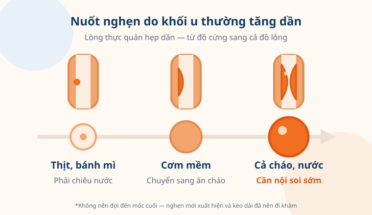
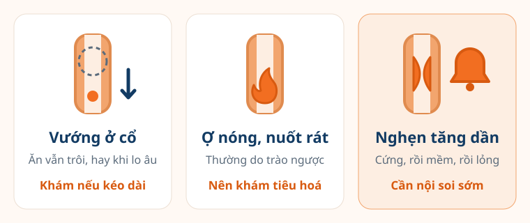

"Dạo này ăn cơm cứ thấy nghẹn ở ngực, phải chiêu thêm ngụm nước mới trôi" —
nhiều người nói câu này rất nhẹ, rồi lặng lẽ tự điều chỉnh: cắt miếng nhỏ
hơn, nhai lâu hơn, bỏ dần miếng thịt, chuyển sang ăn cháo. Vài tháng sau mới
đi khám, khi đã sụt mấy ký.

Ở chiều ngược lại, có người chỉ thấy vướng vướng ở cổ họng khi căng thẳng là
lo mất ngủ. Hai tình huống này **rất khác nhau**. Hiểu được sự khác biệt giúp
bạn không bỏ qua điều cần khám, cũng không hoảng sợ vì điều không đáng.

<figure>
  
  <figcaption>Nuốt nghẹn do khối u thường tăng dần: từ thức ăn cứng sang thức ăn mềm, rồi đến cả chất lỏng. (Ảnh minh họa)</figcaption>
</figure>

## Nuốt nghẹn là gì?

**Nuốt nghẹn** (tiếng y khoa gọi là **khó nuốt — dysphagia**) là cảm giác
thức ăn hoặc nước uống bị mắc lại, đi xuống chậm hoặc không xuống được — ở cổ
hoặc sau xương ức. Theo Hiệp hội Ung thư Hoa Kỳ (ACS), đây là triệu chứng
thường gặp nhất của **ung thư thực quản**: lúc đầu thường nhẹ, rồi nặng dần
khi khối u làm lòng thực quản hẹp lại.

Nói đơn giản: nuốt nghẹn là **thức ăn thật sự bị cản đường**. Điều này khác
với cảm giác **vướng ở cổ** — như có cục gì chặn trong họng, dù ăn uống vẫn
trôi bình thường. Cảm giác vướng kiểu này (tiếng y khoa gọi là **globus**)
thường liên quan đến căng thẳng, lo âu hoặc trào ngược, hay xuất hiện khi
nuốt nước bọt và thường **dịu đi trong lúc ăn**.

## Những hiểu lầm thường gặp

### "Nghẹn chút thôi, uống ngụm nước là trôi, chắc không sao"

**Không đúng.** Chính việc "phải chiêu nước mới trôi" là một tín hiệu cần
chú ý. ACS mô tả người bệnh ung thư thực quản thường **vô thức đổi cách ăn**:
cắn miếng nhỏ hơn, nhai kỹ hơn, tránh bánh mì và thịt, chuyển dần sang đồ
lỏng. Sự thích nghi âm thầm này khiến nhiều người đi khám muộn — ngay cả khi
nghẹn đã kéo dài vài tháng.

### "Cứ nuốt vướng là ung thư thực quản"

**Không đúng.** Phần lớn trường hợp nuốt vướng do bệnh lành tính: trào ngược
dạ dày – thực quản, viêm thực quản, hẹp thực quản do sẹo, rối loạn co bóp
thực quản, viêm họng mạn, hay đơn giản là cảm giác vướng do lo âu. Ung thư là
một khả năng **cần được loại trừ**, chứ không phải điều chắc chắn.

### "Không đau thì không phải bệnh nặng"

**Không đúng.** Ung thư thực quản giai đoạn đầu thường **không đau**. Theo
ACS, đa số trường hợp không gây triệu chứng gì cho đến khi bệnh đã tiến
triển; nuốt đau thường chỉ xuất hiện khi khối u đã lớn. Vì vậy, nuốt nghẹn
không kèm đau vẫn đáng được khám.

## Nuốt nghẹn có thể do những nguyên nhân nào?

- **Trào ngược dạ dày – thực quản** — ợ nóng, ợ chua, nóng rát sau xương ức;
  lâu ngày có thể gây viêm và hẹp thực quản.
- **Hẹp thực quản lành tính** — do sẹo viêm lâu năm, hoặc từng uống nhầm hoá
  chất ăn mòn (nước tẩy rửa, xút).
- **Rối loạn co bóp thực quản**, trong đó có **co thắt tâm vị (achalasia)** —
  hay nghẹn cả đồ đặc lẫn nước ngay từ đầu, đôi khi trớ thức ăn chưa tiêu.
- **Bệnh vùng họng – cổ**: viêm họng mạn, bướu giáp lớn chèn ép, hoặc rối
  loạn nuốt sau đột quỵ (hay sặc, ho khi uống nước).
- **Ung thư thực quản** — điển hình là **nghẹn tăng dần**, từ thức ăn cứng
  sang thức ăn mềm rồi đến chất lỏng, thường kèm sụt cân.

<figure>
  
  <figcaption>Ba kiểu "nuốt vướng" thường gặp và mức độ cần đi khám tương ứng. (Ảnh minh họa)</figcaption>
</figure>

## Ai cần lưu ý nhiều hơn?

Theo ACS, nguy cơ ung thư thực quản cao hơn ở những người:

- **Hút thuốc lá** và **uống rượu bia nhiều** — kết hợp cả hai làm nguy cơ
  tăng vượt xa từng yếu tố riêng lẻ. (Xem thêm: [thuốc lá gây ra những loại
  ung thư nào](/kien-thuc/thuoc-la-va-ung-thu/).)
- **Thường xuyên uống đồ uống rất nóng.** Cơ quan Nghiên cứu Ung thư Quốc tế
  (IARC) của WHO xếp việc uống đồ uống **trên 65°C** vào nhóm "có thể gây
  ung thư" — liên quan chủ yếu đến ung thư thực quản.
- **Trào ngược lâu năm** hoặc đã được chẩn đoán **thực quản Barrett**.
- Từng **uống nhầm hoá chất ăn mòn**, mắc **co thắt tâm vị**, hoặc từng bị
  **ung thư vùng đầu cổ, phổi**.

Tin tốt là nhiều yếu tố trong số này **bạn thay đổi được**: bỏ thuốc lá, hạn
chế rượu bia, để trà, cà phê, canh nguội bớt trước khi uống, và điều trị
trào ngược đúng cách theo hướng dẫn của bác sĩ.

## Khi nào nên đi khám?

Bạn nên đi khám sớm — không đợi thêm — nếu có:

- **Nuốt nghẹn mới xuất hiện**, nhất là khi kéo dài hơn vài tuần hoặc
  **ngày càng nặng hơn**
- Phải đổi cách ăn: cắt nhỏ, ăn mềm, bỏ thịt, ăn chậm hẳn so với trước
- **Sụt cân không rõ nguyên nhân** đi kèm (xem [cách tự tính mức sụt cân
  đáng chú ý](/kien-thuc/sut-can-khong-ro-nguyen-nhan/))
- Nuốt đau, đau hoặc nóng rát sau xương ức kéo dài
- **Khàn tiếng**, ho kéo dài, hay sặc khi ăn uống
- Nôn ra máu, đi cầu phân đen như bã cà phê — trường hợp này cần **đi cấp
  cứu ngay**

Các dấu hiệu này **không đồng nghĩa với ung thư** — rất nhiều bệnh lành tính
như trào ngược, viêm thực quản hay hẹp thực quản do sẹo cũng gây triệu chứng
tương tự — nhưng cần được bác sĩ thăm khám để xác định nguyên nhân và xử trí
sớm. Ở Anh, Viện Y tế và Chăm sóc Xuất sắc (NICE) khuyến cáo người có nuốt
nghẹn được **nội soi tiêu hoá trên trong vòng 2 tuần**, cho thấy đây là triệu
chứng không nên để lâu.

## Đi khám sẽ như thế nào — và bạn chuẩn bị được gì?

Xét nghiệm quan trọng nhất là **nội soi thực quản – dạ dày**: một ống soi mềm,
nhỏ đi qua miệng để bác sĩ nhìn trực tiếp lòng thực quản, và lấy mẫu sinh
thiết nếu thấy chỗ bất thường. Nhiều người sợ nội soi vì nghĩ sẽ khó chịu
lắm. Trên thực tế, hiện nay nhiều nơi có thể **nội soi có gây mê/an thần
nhẹ**, và thủ thuật thường chỉ kéo dài vài phút. (Bài [tầm soát ung thư dạ
dày](/kien-thuc/tam-soat-ung-thu-da-day/) mô tả kỹ hơn về nội soi.)

Để buổi khám hiệu quả, bạn có thể ghi lại trước:

- **Nghẹn từ khi nào**, ở cổ hay sau xương ức, với loại thức ăn nào
- Có **nặng dần** không — trước nghẹn với thịt, giờ nghẹn cả cơm?
- Cân nặng hiện tại so với vài tháng trước
- Thói quen hút thuốc, uống rượu bia, uống đồ nóng; các thuốc đang dùng

> Nuốt nghẹn là một trong số ít dấu hiệu mà cơ thể "báo" khá rõ ràng. Đừng để
> việc tự điều chỉnh bữa ăn che mất tín hiệu ấy — một lần nội soi giúp bạn
> biết chắc nguyên nhân, và yên tâm hơn nhiều so với tự đoán.
