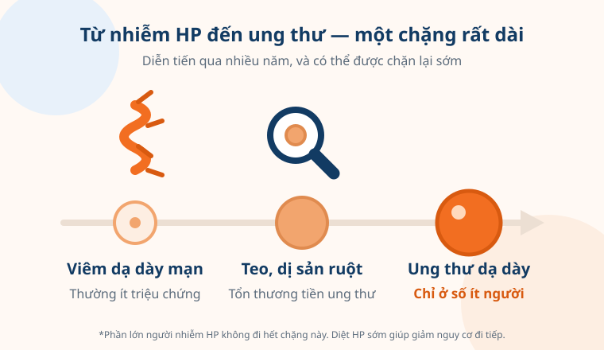
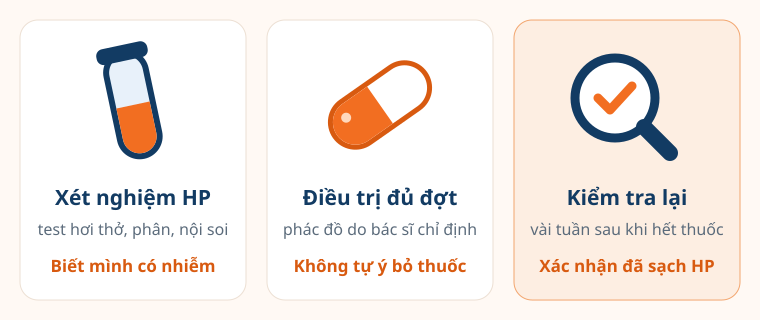

"Bác sĩ ơi, em bị nhiễm HP, vậy là sắp bị ung thư dạ dày rồi phải không?"
Câu hỏi này thường đến ngay sau khi người bệnh cầm tờ kết quả test hơi thở
— kèm theo một đêm mất ngủ vì đọc tin trên mạng.

Nỗi lo đó có cơ sở: vi khuẩn HP đúng là nguyên nhân hàng đầu của ung thư dạ
dày. Nhưng giữa "nhiễm HP" và "ung thư dạ dày" là một chặng đường rất dài,
phần lớn người nhiễm không bao giờ đi hết, và có nhiều điểm để chặn lại sớm.
Hiểu đúng mối liên hệ này giúp bạn bớt hoảng — và biết chính xác nên làm gì.

<figure>
  
  <figcaption>Từ nhiễm HP đến ung thư dạ dày thường mất nhiều năm, qua các giai đoạn có thể phát hiện bằng nội soi. (Ảnh minh họa)</figcaption>
</figure>

## Vi khuẩn HP là gì?

**Helicobacter pylori (HP)** là một loại vi khuẩn hình xoắn sống trong lớp
nhầy phủ mặt trong dạ dày — nơi rất ít vi khuẩn khác tồn tại được. Theo Viện
Ung thư Quốc gia Hoa Kỳ (NCI), HP lây chủ yếu từ người sang người qua đường
miệng: nước bọt, chất nôn hoặc thức ăn, nước uống nhiễm phân. Phần lớn người
nhiễm từ nhỏ, và vi khuẩn có thể tồn tại suốt đời nếu không điều trị.

HP rất phổ biến. Ước tính khoảng hai phần ba dân số thế giới mang vi khuẩn
này. Việt Nam chưa có khảo sát toàn quốc, nhưng một nghiên cứu cộng đồng ở
Hà Nội và Hà Tây (2005) ghi nhận khoảng **ba phần tư** người tham gia có dấu
hiệu từng hoặc đang nhiễm HP.

Năm 1994, Cơ quan Nghiên cứu Ung thư Quốc tế (IARC) của WHO xếp HP vào
**nhóm tác nhân gây ung thư ở người**. Theo NCI, phần lớn các ca ung thư biểu
mô tuyến dạ dày và u lympho MALT dạ dày được quy cho tình trạng nhiễm HP.

Nói đơn giản: HP không gây ung thư "ngay", mà gây **viêm dạ dày kéo dài**
nhiều năm. Ở một số người, niêm mạc bị viêm lâu ngày mỏng dần (**viêm teo**),
rồi biến đổi giống niêm mạc ruột (**dị sản ruột**) — đây là các tổn thương
tiền ung thư. Chỉ một phần nhỏ trong số đó tiến tới ung thư. Ăn mặn, đồ muối
chua, thịt chế biến sẵn và hút thuốc lá làm chặng đường này nhanh hơn.

## Những hiểu lầm thường gặp

### "Nhiễm HP là sớm muộn gì cũng bị ung thư dạ dày"

**Không đúng.** Đa số người nhiễm HP chỉ bị viêm dạ dày mạn, nhiều người
không hề có triệu chứng, và chỉ một phần nhỏ đi đến ung thư. Nguy cơ cụ thể
khác nhau theo vùng địa lý, tuổi, chủng vi khuẩn, chế độ ăn và tiền sử gia
đình — nên cùng là "dương tính HP", mỗi người cần được bác sĩ đánh giá riêng.

HP là yếu tố nguy cơ **quan trọng nhất**, nhưng không phải bản án. Và khác
với tuổi tác hay di truyền, đây là yếu tố bạn xử lý được.

### "Diệt HP xong là hết nguy cơ ung thư dạ dày"

**Không đúng — nhưng giảm đáng kể.** Tổng hợp của Cochrane (2020) trên 7 thử
nghiệm với hơn 8.000 người khỏe mạnh nhiễm HP, phần lớn ở châu Á, cho thấy
điều trị diệt HP giúp **giảm gần một nửa** số ca ung thư dạ dày về sau so với
không điều trị, đồng thời giảm tử vong do ung thư dạ dày.

Tuy vậy, nguy cơ không về 0. Nếu dạ dày **đã có viêm teo hoặc dị sản ruột**
trước khi diệt HP, tổn thương đó không mất đi ngay — bạn vẫn cần nội soi
theo dõi định kỳ theo hẹn của bác sĩ. HP cũng có thể **tái nhiễm**, nhất là
khi người sống cùng nhà vẫn mang vi khuẩn. Diệt HP càng sớm, trước khi niêm
mạc kịp tổn thương, thì lợi ích càng rõ.

### "Không đau bụng thì không cần quan tâm đến HP"

**Không đúng.** Phần lớn người nhiễm HP không có triệu chứng gì, và các tổn
thương tiền ung thư cũng thường "im lặng". Ngược lại, đau thượng vị, đầy bụng
không nhất thiết là do HP. Cảm giác của dạ dày không phải thước đo đáng tin —
xét nghiệm mới trả lời được bạn có nhiễm hay không.

### "Nhiễm HP thì tự mua thuốc uống cho nhanh"

**Không nên.** Điều trị HP cần phối hợp nhiều loại thuốc, trong đó có kháng
sinh. Tổng hợp nghiên cứu tại Việt Nam (tạp chí Gut and Liver, 2019) cho thấy
HP ở nước ta **kháng kháng sinh ở mức cao** — với clarithromycin, một kháng
sinh hay dùng, khoảng một phần ba chủng vi khuẩn đã kháng ngay từ lần điều
trị đầu, và tỉ lệ này đang tăng.

Tự mua thuốc, uống không đủ đợt hoặc dùng sai phối hợp dễ khiến điều trị thất
bại, vi khuẩn kháng thuốc thêm, và lần điều trị sau khó hơn. Bác sĩ sẽ chọn
phác đồ phù hợp với tình hình kháng thuốc và tiền sử dùng thuốc của bạn.

## Xét nghiệm và điều trị HP gồm những gì?

<figure>
  
  <figcaption>Xử trí HP là một quy trình ba bước — bước kiểm tra lại sau điều trị hay bị bỏ qua nhất. (Ảnh minh họa)</figcaption>
</figure>

- **Test hơi thở (test urê)** — thổi vào túi hoặc ống mẫu, không đau, cho biết
  bạn có đang nhiễm HP hay không. Đây là cách phổ biến nhất.
- **Xét nghiệm tìm kháng nguyên HP trong phân** — cũng không xâm lấn, dùng
  được cả trước và sau điều trị.
- **Nội soi dạ dày kèm sinh thiết** — khi cần quan sát trực tiếp niêm mạc, ví
  dụ người có triệu chứng báo động, người từ 40 tuổi hoặc có nguy cơ cao. Nội
  soi vừa tìm HP, vừa phát hiện viêm teo, dị sản ruột hay tổn thương sớm.
  Chi tiết về nội soi và ai nên tầm soát có trong bài
  [tầm soát ung thư dạ dày](/kien-thuc/tam-soat-ung-thu-da-day/).
- **Xét nghiệm máu tìm kháng thể** ít được ưu tiên hơn, vì kết quả dương tính
  không phân biệt được đang nhiễm hay đã từng nhiễm.
- **Điều trị theo phác đồ** gồm thuốc giảm tiết acid phối hợp kháng sinh,
  uống trong một đợt theo chỉ định. Uống đủ, đúng giờ, không tự ý bỏ giữa
  chừng dù đã thấy dễ chịu.
- **Kiểm tra lại sau điều trị** bằng test hơi thở hoặc xét nghiệm phân, sau
  khi ngưng thuốc một thời gian theo hẹn — để chắc chắn vi khuẩn đã sạch.

Một lưu ý thực tế: thuốc giảm tiết acid và kháng sinh có thể làm test hơi
thở, xét nghiệm phân **âm tính giả**. Nếu đang dùng các thuốc này, hãy báo bác
sĩ trước khi xét nghiệm để được hướng dẫn thời điểm ngưng thuốc phù hợp.

> Mục tiêu không chỉ là "uống thuốc diệt HP", mà là **xác nhận đã sạch HP** —
> và theo dõi tiếp nếu dạ dày đã có tổn thương từ trước.

## Khi nào nên đi xét nghiệm HP?

Bạn nên trao đổi với bác sĩ về việc xét nghiệm HP nếu:

- **Có người thân trực hệ** (cha mẹ, anh chị em, con) từng bị ung thư dạ dày.
  Một thử nghiệm tại Hàn Quốc công bố trên tạp chí NEJM (2020) cho thấy ở nhóm
  này, điều trị diệt HP giúp giảm rõ nguy cơ ung thư dạ dày về sau.
- **Đang hoặc từng bị viêm loét dạ dày – tá tràng**, hoặc khó tiêu, đầy bụng,
  đau thượng vị kéo dài.
- **Đã được chẩn đoán viêm teo, dị sản ruột** hoặc từng cắt tổn thương sớm ở
  dạ dày.
- **Người sống cùng nhà đang nhiễm HP**, đặc biệt khi bạn có thêm yếu tố nguy
  cơ khác.
- **Từ 40 tuổi** và có lối sống nguy cơ: ăn mặn, hay ăn đồ muối chua, hút
  thuốc, uống rượu bia nhiều.
- **Đã điều trị HP** nhưng chưa từng kiểm tra lại xem vi khuẩn đã sạch chưa.

Ngoài ra, các dấu hiệu sau cần **đi khám ngay**, không đợi xét nghiệm HP hay
lịch tầm soát:

- Đau thượng vị kéo dài, tái đi tái lại, không đỡ khi dùng thuốc thông thường
- Nuốt nghẹn, ăn ít đã no, đầy bụng kéo dài
- Nôn ra máu, đi cầu phân đen như bã cà phê
- Sụt cân không rõ nguyên nhân, mệt mỏi, da xanh xao (thiếu máu)

Các dấu hiệu này **không đồng nghĩa với ung thư** — viêm loét dạ dày, trào
ngược hay nhiều bệnh lành tính khác cũng gây triệu chứng tương tự — nhưng cần
được bác sĩ thăm khám để tìm nguyên nhân và xử trí sớm. Xem thêm
[10 dấu hiệu cảnh báo ung thư không nên bỏ qua](/kien-thuc/dau-hieu-canh-bao-ung-thu/)
và [những hiểu lầm phổ biến về ung thư](/kien-thuc/hieu-lam-pho-bien-ve-ung-thu/).

> Nhiễm HP không phải bản án, mà là một tín hiệu đến sớm. Ung thư dạ dày cần
> nhiều năm để hình thành — và một lần xét nghiệm, một đợt điều trị đúng cách
> hôm nay có thể giúp bạn chặn nó lại từ rất xa.
